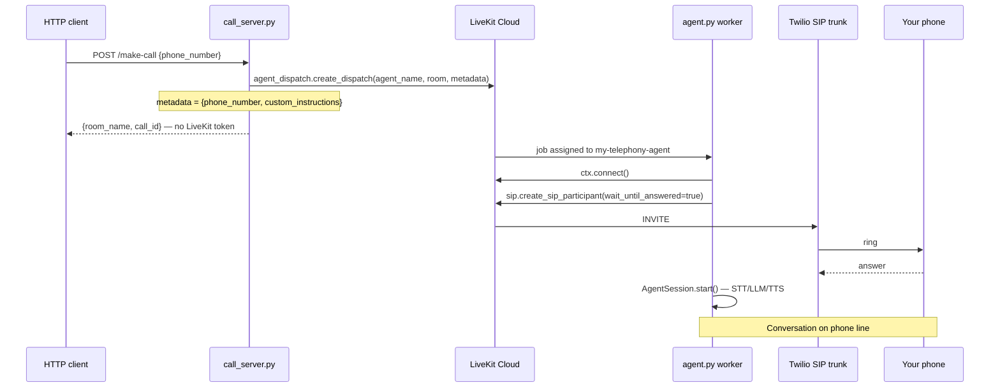

# Call Agent Reference (working) vs Helpline POC (current)

This doc is based on the **working** project at:

```
C:\Users\Rikhil Nellimarla\Projects\call agent\
  agent.py          ← LiveKit worker (voice + SIP dial)
  call_server.py    ← HTTP API (triggers outbound only)
```

Read these two files before changing helpline telephony again.

---

## What call agent is

A minimal **outbound phone dialer**:

1. You POST a phone number to a FastAPI server.
2. The server tells LiveKit to dispatch a named worker into a room.
3. The worker connects, dials the phone via SIP, and runs the voice agent when the callee answers.

There is **no dashboard**, **no Postgres**, **no RAG**, **no browser call UI** in the outbound path. Your phone ringing *is* the success signal.

---

## How to turn on call agent (proven procedure)

Two terminals. Same `.env` in the project root.

### Terminal 1 — worker (must be running first)

```powershell
cd "C:\Users\Rikhil Nellimarla\Projects\call agent"
uv run python agent.py dev
```

Wait until you see:

```
registered worker {"agent_name": "my-telephony-agent", ...}
```

### Terminal 2 — HTTP API

```powershell
cd "C:\Users\Rikhil Nellimarla\Projects\call agent"
uv run python call_server.py
```

Or:

```powershell
uv run uvicorn call_server:app --host 0.0.0.0 --port 8000
```

### Trigger an outbound call

```powershell
curl -X POST http://localhost:8000/make-call `
  -H "Content-Type: application/json" `
  -d '{"phone_number": "+917380175224"}'
```

Or open `http://localhost:8000/docs` → `POST /make-call`.

### What you should see

| Where | Expected log |
|-------|----------------|
| **call_server** | `Dispatch created successfully`, room name like `outbound-call-917380175224-<uuid>` |
| **agent.py worker** | `received job request` → `Placing outbound call` → `Call connected successfully` |
| **Your phone** | Rings from the Twilio/LiveKit trunk number |

Check status (optional):

```powershell
curl http://localhost:8000/call-status/<room_name>
```

Hang up:

```powershell
curl -X DELETE http://localhost:8000/end-call/<room_name>
```

---

## Required environment variables (call agent)

From `.env.example`:

| Variable | Purpose |
|----------|---------|
| `LIVEKIT_URL` | e.g. `wss://call-agent-75i81x04.livekit.cloud` |
| `LIVEKIT_API_KEY` | LiveKit project API key |
| `LIVEKIT_API_SECRET` | LiveKit project API secret |
| `SIP_TRUNK_ID` | LiveKit outbound trunk ID (e.g. `ST_EdhhfeXqDent`) |
| `OPENAI_API_KEY` | LLM |
| `DEEPGRAM_API_KEY` | STT |
| `CARTESIA_API_KEY` | TTS (Cartesia, not Deepgram TTS) |

Optional / not needed for basic dial:

| Variable | Purpose |
|----------|---------|
| `WEBSOCKET_URL` | Pushes call status to an external backend — **not used for dialing** |
| `CALL_FORWARDING_NUMBER` | Human transfer via `escalate_to_human` tool |
| Langfuse vars | Tracing only |

**Critical:** `AGENT_NAME` in code is hardcoded as `"my-telephony-agent"` in **both** files. They must match exactly.

---

## Outbound call flow (call agent)



### Exact responsibilities

**call_server.py** (API only):

- Validates `phone_number` starts with `+`
- Builds room name: `outbound-call-{digits}-{uuid4}`
- Calls **only** `agent_dispatch.create_dispatch`
- Does **not** create a room
- Does **not** mint a browser token
- Does **not** dial SIP itself

**agent.py** (worker only):

- Registers as `agent_name="my-telephony-agent"` via `WorkerOptions` + `cli.run_app`
- Reads `phone_number` from `ctx.job.metadata` (JSON)
- `await ctx.connect()`
- `create_sip_participant` with `wait_until_answered=True`, trunk from `SIP_TRUNK_ID`
- Starts `AgentSession` **after** SIP connects
- Outbound: does **not** greet first — waits for callee (`on_enter` only greets inbound)

---

## Features in call agent that helpline does NOT need

| call agent feature | Helpline relevance |
|--------------------|-------------------|
| WebSocketManager → external `WEBSOCKET_URL` | Skip — use LiveKit `useTranscriptions()` in dashboard instead |
| Langfuse / OpenTelemetry tracing | Nice-to-have, not for demo |
| `analyze_customer_interest` on hangup | Sales-specific, not 1930 helpline |
| `escalate_to_human` + SIP transfer | Future; not core POC |
| Voicemail detection tool | Optional later |
| Cartesia TTS + `sonic-2` voice | Helpline uses Deepgram TTS (`aura-2-thalia-en`) |
| Custom roofing instructions in `/make-call` | Replace with DB agent instructions |
| `call-status` / `end-call` endpoints | Useful pattern; helpline has partial equivalents |

---

## Features helpline has that call agent lacks

| Helpline feature | Status in helpline POC |
|------------------|------------------------|
| **Knowledge base (RAG)** | Implemented (`knowledge.py`, markitdown, pgvector) — call agent has none |
| **Per-agent BYOK** (OpenAI/Deepgram keys in UI) | Implemented in DB + worker |
| **Agent config UI** | Basic (not shadcn-polished) |
| **Inbound via Twilio number** | `telephony.py` + dispatch rule — not in call agent files |
| **Call history / transcript persistence** | Postgres `Call` table + worker shutdown callback |
| **Dashboard listen-in** | Intended via listen-only token — **currently broken UX** |
| **Web call (browser mic test)** | Separate path; not the demo path |

---

## Why call agent works and helpline outbound broke

Honest diff — not guesses about “architecture”.

### 1. Worker registration model differs

| | call agent (works) | helpline (broken) |
|--|-------------------|-------------------|
| SDK | `livekit-agents` **1.2.8** | `livekit-agents` **1.8.2** |
| Worker API | `WorkerOptions(entrypoint_fnc=entrypoint, agent_name="...")` | `AgentServer` + `@server.rtc_session(agent_name=...)` |
| CLI | `python agent.py dev` | `python -m helpline.worker dev` |

Same LiveKit project, different SDK generations. **Do not assume 1.8 `AgentServer` behaves identically to 1.2 `WorkerOptions` for explicit dispatch.**

### 2. API contract differs (this caused the “Connecting forever” UI)

| | call agent | helpline |
|--|-----------|----------|
| Outbound API returns | `{room_name, call_id}` only | `{room, token, url, mode: "listen", ...}` |
| Browser joins LiveKit on dial? | **No** | **Yes — immediately** |
| SIP dial location | Worker only | Worker only (after fix) — but UI already opened empty room |

Call agent never tries to WebRTC-connect the browser when dialing out. Helpline opens `CallRoom` and waits for participants that never appear if the worker never joins.

### 3. Metadata key name

| call agent | helpline API | helpline worker |
|-----------|--------------|-----------------|
| `phone_number` | `phone` | accepts both (patched) |

Match call agent: use `phone_number` in dispatch metadata.

### 4. Agent name must match everywhere

| call agent | helpline |
|-----------|----------|
| `"my-telephony-agent"` in call_server + agent.py | `"helpline"` in api + worker + possibly LiveKit Cloud deployment |

If LiveKit Cloud has a **deployed cloud agent** also named `helpline`, it may receive dispatches while your local worker sits idle (API returns 200, worker shows only `registered worker`).

**Check:** LiveKit Cloud → Agents → disable/delete cloud deployment, or use a unique local name like `helpline-local`.

### 5. SIP participant details

call agent (working):

```python
await ctx.api.sip.create_sip_participant(api.CreateSIPParticipantRequest(
    room_name=ctx.room.name,
    sip_trunk_id=trunk_id,           # from SIP_TRUNK_ID env
    sip_call_to=phone_number,
    participant_identity=f"sip_{phone_number}",
    wait_until_answered=True,
))
```

No `sip_number` field. Trunk defines caller ID.

### 6. Room creation

call agent: **does not** call `create_room` before dispatch — dispatch + worker join creates the room.

helpline: added `create_room` before dispatch — not the root cause of worker not receiving jobs.

### 7. Twilio trial constraints (both projects)

- Outbound number must be **verified** in Twilio Console.
- **Geo Permissions** must allow India (`+91`) if dialing from US trunk.
- Trial trunk must be configured on LiveKit outbound trunk `ST_EdhhfeXqDent`.

---

## Helpline startup (current)

```powershell
cd cybercrime-helpline-poc
.\scripts\dev.ps1
```

Starts: Postgres (Docker) → API `:8000` → worker → Vite `:5173`.

**Env file:** `backend/.env` (not repo root).

---

## Recommended fix order for helpline demo

Do these in order. Do not polish UI until step 3 passes.

### Step 1 — Prove dial with call agent pattern on helpline credentials

Copy the **exact** worker bootstrap from call agent into helpline temporarily:

- Switch worker to `WorkerOptions(entrypoint_fnc=..., agent_name=settings.agent_name)`
- Or downgrade to `livekit-agents~=1.2` (heavier)

Until `job received` appears in worker logs after `POST /api/calls/phone`, nothing else matters.

### Step 2 — Simplify outbound API response

For phone outbound, match call agent:

- Dispatch only
- Return `{room, call_id, phone, status: "dialing"}`
- **Do not** return a listen token until worker is in room (or drop listen-in for demo)

### Step 3 — Verify end-to-end

1. Worker log: `job received room=outbound-...`
2. Worker log: `Call connected successfully` or clear SIP error
3. Phone rings

### Step 4 — Re-add helpline-only features

Once dial works:

- RAG `search_knowledge` tool (already in worker)
- BYOK from DB
- Dashboard listen via `useTranscriptions()` after worker is live
- Inbound dispatch rule

---

## Quick comparison table

| Concern | call agent | helpline POC |
|---------|-----------|--------------|
| Outbound trigger | `POST /make-call` | `POST /api/calls/phone` |
| Agent name | `my-telephony-agent` | `helpline` |
| Worker entry | `entrypoint()` function | `@server.rtc_session` |
| Phone in metadata | `phone_number` | `phone` |
| SIP trunk env | `SIP_TRUNK_ID` | `SIP_OUTBOUND_TRUNK_ID` |
| TTS | Cartesia | Deepgram |
| Database | none | Postgres + pgvector |
| RAG | none | markitdown + embeddings |
| Dashboard | none (optional WebSocket) | React + LiveKit components |
| Demo success signal | phone rings | phone rings (not “Connecting” in browser) |

---

## Files to read before changing telephony

**Working reference:**

- `C:\Users\Rikhil Nellimarla\Projects\call agent\agent.py`
- `C:\Users\Rikhil Nellimarla\Projects\call agent\call_server.py`

**Helpline (current):**

- `backend/src/helpline/worker.py` — worker + SIP dial
- `backend/src/helpline/api.py` — `open_room`, `/api/calls/phone`
- `backend/src/helpline/telephony.py` — inbound trunk + dispatch rule
- `backend/.env` — keys (never commit)
- `web/src/App.tsx` — dial UI (opens LiveKit too early)

---

## curl cheat sheet (helpline API today)

```powershell
# Health
curl http://127.0.0.1:8000/api/health

# Outbound (current — returns listen token)
curl -X POST http://127.0.0.1:8000/api/calls/phone `
  -H "Content-Type: application/json" `
  -d '{"phone": "+917380175224"}'

# List live rooms
curl http://127.0.0.1:8000/api/rooms
```

If outbound works, `/api/rooms` should show the room with `participants >= 1` within ~10s of dispatch.

---

*Last updated: 2026-09-23 — based on user's working `call agent` repo and current helpline POC state.*
